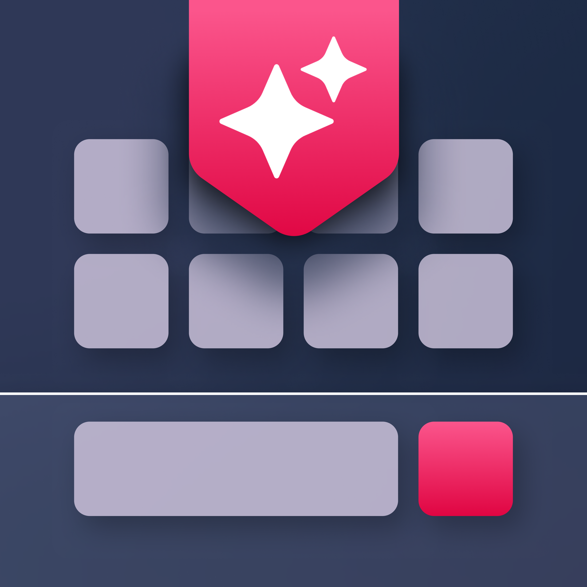

<p align="center">
  
</p>

# Teklado

**Teklado by NextLayer Labs** is a private, customizable Android keyboard (*teklado* is Filipino for "keyboard").
It is a fork of [HeliBoard](https://github.com/Helium314/HeliBoard) with its own look, built-in glide typing and
extra features aimed at fast bilingual (Filipino / English) typing.

> Status: early beta. Things work, but expect rough edges.

## What's in it

- **Glide typing** with a built-in, open-source decoder (no closed-source library needed). *Experimental.*
- Autocorrect, suggestions, clipboard history, themes with your own background image, resizable keyboard.
- **Menu and pinned keys**: tap the menu icon for every tool; pin your favorites (clipboard, voice, undo by default) to the top bar.
- **Emoji Kitchen**: type two emojis and tap the sticker that appears. Sticker images are fetched from Google's servers only when used.
- A new dashboard-style settings app and onboarding.

Planned: Whisper voice typing (Groq), Filipino ⇄ English AI translation and an AI/search bar (OpenRouter), bring-your-own API keys.

## Privacy

- Typing, glide, autocorrect and clipboard are fully on-device.
- The only network feature today is Emoji Kitchen, and it only requests the image for the emoji pair you typed or tapped.
  All network calls go through one small allowlisted client (`latin/net/TekladoNet.kt`).
- Future cloud features (voice, translate, AI) will only run when you press their button, with your own API keys.

## Build

Requires JDK 21, the Android SDK (platform 37) and NDK `28.0.13004108`.

```bash
./gradlew assembleDebug
```

The debug APK is written to `app/build/outputs/apk/debug/`.

## Credits and license

Teklado is free software under the **GNU GPL v3** (see [LICENSE](LICENSE)).

- Based on [HeliBoard](https://github.com/Helium314/HeliBoard) by Helium314 and contributors (forked at commit `44ddb1a`),
  which is in turn based on OpenBoard and the Android Open Source Project keyboard (Apache-2.0, see [LICENSE-Apache-2.0](LICENSE-Apache-2.0)).
- Glide decoder: written for Teklado, following the SHARK2 approach of Kristensson and Zhai.
- Emoji Kitchen pair data comes from [xsalazar/emoji-kitchen-backend](https://github.com/xsalazar/emoji-kitchen-backend)
  (the data behind [emojikitchen.dev](https://emojikitchen.dev)). The sticker images are Google's and are not bundled.
- The Teklado name and logo are © NextLayer Labs.
